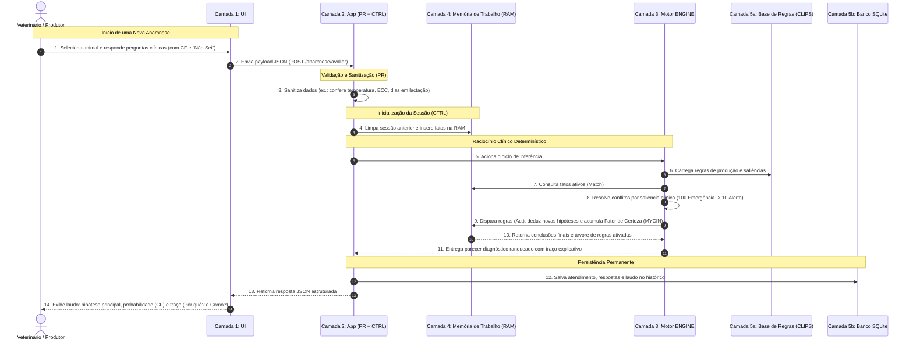
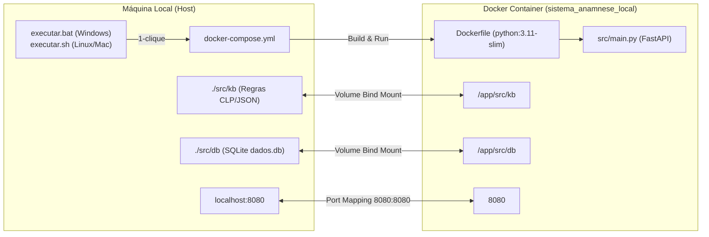

# Arquitetura e Relacionamento de Componentes
## Sistema Especialista LactaExpert — Pecuária Leiteira (UFJF 2026)

Este documento descreve detalhadamente a arquitetura de software, a divisão em camadas, os arquivos de infraestrutura e o fluxo de dados do **LactaExpert**, desenvolvido para o **Hackathon UFJF 2026 (Tema T1: Anamnese e Triagem Animal)**.

---

## 1. Visão Geral da Arquitetura em 5 Camadas

O sistema adota um padrão arquitetural em **5 camadas desacopladas**, onde cada pacote possui responsabilidade única e bem delimitada. O objetivo é isolar a interface, o controle de sessão, o raciocínio dedutivo, a memória volátil e a persistência de conhecimento/dados.

```mermaid
graph TB
    subgraph Host["Host (Máquina do Usuário - Localhost:8080)"]
        Browser["👤 Produtor / Veterinário (Navegador Web)"]
        
        subgraph Container["Container Docker: sistema_anamnese_local"]
            Server["src/main.py (Servidor FastAPI / Uvicorn)"]
            
            subgraph C1["Camada 1: Interface do Usuário"]
                UI["src/ui/<br/>Telas, Componentes e Exibição de Laudos"]
            end
            
            subgraph C2["Camada 2: Aplicação e Orquestração"]
                APP["src/app/<br/>Validação de Inputs (PR) & Controlador de Sessão (CTRL)"]
            end
            
            subgraph C3["Camada 3: Motor de Inferência"]
                ENGINE["src/engine/<br/>Forward Chaining, Saliência & Fator de Certeza (MYCIN)"]
            end
            
            subgraph C4["Camada 4: Memória Temporária"]
                WM["src/wm/<br/>Memória de Trabalho (RAM Volátil)"]
            end
            
            subgraph C5["Camada 5: Conhecimento e Dados"]
                KB["src/kb/<br/>Base de Regras (CLIPS / JSON)"]
                DB["src/db/<br/>SQLite (dados.db)"]
            end
        end
        
        VolKB[("Volume Persistente Local:<br/>./src/kb")]
        VolDB[("Volume Persistente Local:<br/>./src/db")]
    end

    Browser <-->|HTTP / JSON (Porta 8080)| Server
    Server --> UI
    UI <-->|Comunicação Exclusiva| APP
    APP <-->|Injeta Fatos / Consulta Estado| WM
    APP <-->|Dispara Ciclo de Inferência| ENGINE
    ENGINE <-->|Lê Fatos & Escreve Deduções| WM
    ENGINE -->|Carrega Regras e Pesos| KB
    APP -->|Grava Histórico e Consulta Cadastros| DB

    KB -.->|Espelhado via Docker| VolKB
    DB -.->|Espelhado via Docker| VolDB

    style Container fill:#f8f9fa,stroke:#333,stroke-width:2px
    style C1 fill:#e1f5fe,stroke:#0288d1
    style C2 fill:#fff3e0,stroke:#f57c00
    style C3 fill:#ede7f6,stroke:#7e57c2
    style C4 fill:#e8f5e9,stroke:#388e3c
    style C5 fill:#fbe9e7,stroke:#d84315
```

---

## 2. Mapa Detalhado das Pastas e Responsabilidades

| Camada / Pasta | Responsabilidade Principal | O que faz | O que NÃO faz |
| :--- | :--- | :--- | :--- |
| **`src/ui/`**<br>(Camada 1) | **Interface do Usuário** | Exibe perguntas da anamnese, captura cliques/respostas com Fator de Certeza (CF), exibe laudo ranqueado e módulo explicativo (*Por quê?* e *Como?*). | **Não** valida regras sanitárias, **não** calcula diagnósticos e **não** acessa banco de dados diretamente. |
| **`src/app/`**<br>(Camada 2) | **Aplicação (PR + CTRL)** | **PR:** Sanitiza entradas (ex.: valida se a temperatura está entre 35,0 °C e 43,0 °C).<br>**CTRL:** Controla a sessão do atendimento, coordena o fluxo entre UI, WM e ENGINE, e salva o laudo no banco. | **Não** executa o raciocínio dedutivo nem armazena conhecimento clínico. |
| **`src/engine/`**<br>(Camada 3) | **Motor de Inferência** | Executa o ciclo dedutivo *Match-Resolve-Act* por encadeamento para frente (*Forward Chaining*), resolve conflitos por saliência (prioridade clínica) e calcula o Fator de Certeza acumulado (MYCIN). | **Não** interage com telas nem grava dados em disco. |
| **`src/wm/`**<br>(Camada 4) | **Memória de Trabalho (WM)** | Armazena em memória RAM o estado volátil da consulta atual: fatos primitivos informados e conclusões intermediárias geradas pelo motor. Reinicia a cada novo atendimento. | **Não** persiste dados em disco após o término da sessão. |
| **`src/kb/`**<br>(Camada 5a) | **Base de Conhecimento** | Arquivo declarativo (`base_regras.clp` ou JSON) contendo as regras de produção (`SE ... ENTÃO`), pesos de evidência e saliências para os 3 pilares clínicos (glândula mamária, periparto e infecções/parasitárias). | **Não** processa lógica procedural; é apenas conhecimento declarativo versionado. |
| **`src/db/`**<br>(Camada 5b) | **Banco de Dados Local** | Persistência relacional em SQLite (`dados.db`) contendo fichas cadastrais dos animais, histórico de anamneses e laudos auditáveis gerados. | **Não** faz inferência; armazena apenas dados estruturados permanentes. |
| **`docs/`** | **Documentação** | Centraliza todas as 10 especificações clínicas e arquiteturais do projeto, além dos editais e apresentações do evento. | Apenas documentação de referência. |
| **`tests/`** | **Testes Automatizados** | Suíte de testes com `pytest` e `TestClient` para garantir que rotas e contratos da API funcionem corretamente. | Apenas código de teste. |

---

## 3. Fluxo de Execução de uma Anamnese (Ciclo de Vida)

O diagrama de sequência abaixo demonstra exatamente como os componentes se comunicam desde o momento em que o usuário inicia a triagem até a exibição do laudo explicável:



---

## 4. Infraestrutura Docker e Relacionamento com o Host

A conteinerização foi projetada para que a equipe desenvolva sem atritos de instalação de dependências locais:



### Por que os Volumes em `src/kb` e `src/db` são Essenciais?
1. **`./src/kb:/app/src/kb` (Edição sem rebuild):**  
   Permite que a equipe adicione, edite ou refine regras no arquivo [src/kb/base_regras.clp](file:///c:/Users/joaom/Anamnese-bovina/src/kb/base_regras.clp) diretamente no editor do computador. As alterações são refletidas instantaneamente dentro do container sem necessidade de refazer o build da imagem Docker.
2. **`./src/db:/app/src/db` (Persistência real):**  
   Garante que o arquivo `dados.db` gerado pelo SQLite não seja perdido ao parar (`docker compose down`) ou reiniciar o container. Os cadastros e históricos ficam salvos no disco da máquina física.

---

## 5. Como Cada Arquivo da Raiz se Encaixa no Todo

- **[Dockerfile](file:///c:/Users/joaom/Anamnese-bovina/Dockerfile):** Define o ambiente padronizado com `python:3.11-slim`, instala dependências do [requirements.txt](file:///c:/Users/joaom/Anamnese-bovina/requirements.txt), configura variáveis não-bufferizadas (`PYTHONDONTWRITEBYTECODE=1` e `PYTHONUNBUFFERED=1`) e define o comando `python src/main.py`.
- **[docker-compose.yml](file:///c:/Users/joaom/Anamnese-bovina/docker-compose.yml):** Orquestra o container com nome fixo `sistema_anamnese_local`, faz o bind mount dos volumes de dados/regras e mapeia a porta `8080:8080`.
- **[requirements.txt](file:///c:/Users/joaom/Anamnese-bovina/requirements.txt):** Especifica `fastapi`, `uvicorn`, `pydantic`, `pytest` e deixa `clipspy` preparado e documentado para uso com o motor CLIPS nativo.
- **[src/main.py](file:///c:/Users/joaom/Anamnese-bovina/src/main.py):** Ponto de entrada do backend. Responde com status online na rota `GET /` e disponibiliza a conferência das camadas na rota `GET /health`.
- **[executar.bat](file:///c:/Users/joaom/Anamnese-bovina/executar.bat) / [executar.sh](file:///c:/Users/joaom/Anamnese-bovina/executar.sh):** Scripts automatizados de 1-clique para inicializar todo o ambiente no terminal exibindo os links úteis.
- **[.gitignore](file:///c:/Users/joaom/Anamnese-bovina/.gitignore):** Protege o repositório impedindo o commit acidental de bancos locais (`*.db`), arquivos temporários, caches do Python e ambientes virtuais.
- **[CLAUDE.md](file:///c:/Users/joaom/Anamnese-bovina/CLAUDE.md):** Manual de diretrizes e regras de ouro para assistentes de IA (contextualização rápida em prompts futuros).
- **[tests/test_api.py](file:///c:/Users/joaom/Anamnese-bovina/tests/test_api.py):** Garantia de qualidade por testes de integração automatizados com `pytest`.

---

## 6. A Regra de Ouro do Hackathon

> **Determinismo e Auditabilidade Clínica:**  
> A Inteligência Artificial Generativa (LLMs) atua exclusivamente como ferramenta de produtividade para os desenvolvedores (*Vibe Coding*, geração de código, testes e apoio à engenharia de requisitos).  
> **A tomada de decisão diagnóstica em tempo de execução NUNCA é delegada a uma LLM.** O diagnóstico provém exclusivamente da base formal de conhecimento e das equações de Fator de Certeza do motor de inferência, tornando cada conclusão 100% reproduzível, auditável e explicável para o veterinário.
